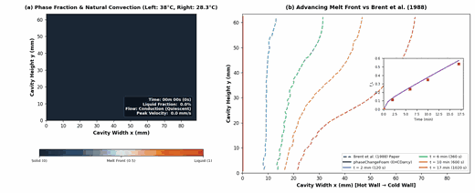

# phaseChangeFoam

[](https://github.com/chinmay-s-patil/phaseChangeFoam/actions/workflows/ci.yml)
[](https://www.openfoam.com)
[](https://github.com/chinmay-s-patil/phaseChangeFoam/actions/workflows/docker.yml)
[](https://github.com/chinmay-s-patil/phaseChangeFoam/pkgs/container/phasechangefoam)
[](https://github.com/chinmay-s-patil/phaseChangeFoam/releases)
[](LICENSE)

`phaseChangeFoam` is a multi-region conjugate heat transfer (CHT) solver suite for OpenFOAM with integrated phase change physics. It provides solid-liquid phase change materials (PCM) with thermal hysteresis and Darcy mushy-zone drag, as well as species evaporation and boiling kinetics across coupled solid and fluid domains.

> **Status**: Research code tested on OpenFOAM-v2412. Release v0.1.0; interfaces and keyword specifications are subject to refinement.

---

## Features and Available Models

`phaseChangeFoam` extends OpenFOAM's standard `chtMultiRegionFoam` (OpenCFD / ESI-OpenCFD) conjugate heat transfer architecture and monolithic coupled energy framework (`coupledEnergyField`, `useImplicit`) with dedicated phase change capabilities:

* **Thermal hysteresis in solid-liquid PCM**: Stateful direction-dependent melting and freezing paths with subcooling tracking (`phaseState`, `T_reversal`).
* **Effective heat capacity (`EHC`, `EHCDarcy`)**: Uses a path-based sensible heat capacity to account for temperature-dependent solid and liquid properties. Latent heat is handled separately through source and linearisation terms. `EHC` is designed for solid regions or conduction-only domains (lacking momentum damping; convection is prevented in fluid regions), while `EHCDarcy` adds implicit Darcy momentum damping when fluid motion is modeled.
* **Adaptive time-step limiting (`maxAlphaCo`)**: Constrains $\Delta t$ based on the maximum cell-wise rate of phase fraction change, preventing the interface from skipping cells without resolving the phase transition.
* **Volumetric species phase change (`Lee`)**: Implements volumetric evaporation and boiling within fluid regions, with thermal energy coupled across solid-fluid conjugate boundaries via CHT interfaces (species mass transfer is confined within fluid domains).

### Solvers

| Solver | Description | Time Formulation |
| :--- | :--- | :--- |
| `phaseChangeMultiRegionFoam` | Multi-region transient CHT with species phase change and solid-liquid PCM | PIMPLE |
| `phaseChangeMultiRegionSimpleFoam` | Multi-region steady-state CHT with natural convection and thermal phase change | SIMPLE |

### Phase Change Models

| Model | Domain | Formulation | Primary Mechanisms |
| :--- | :--- | :--- | :--- |
| `EHCDarcy` | Solid / Fluid | Effective Heat Capacity + Darcy drag | Path-based sensible capacity, linearised latent heat sources, Carman-Kozeny Darcy damping |
| `EHC` | Solid / Fluid (conduction only) | Effective Heat Capacity | Path-based sensible capacity, linearised latent heat sources, subcooling hysteresis (no Darcy drag; convection must be suppressed in fluids) |
| `enthalpyPorosity` | Solid / Fluid | Enthalpy-porosity (Voller and Prakash) | Newton projection on liquid fraction, mushy-zone Darcy drag |
| `Lee` | Fluid | Volumetric species mass/energy transfer | Evaporation and condensation, optional Clausius-Clapeyron $T_{\text{sat}}(p)$ |
| `constantSource` | Fluid | Fixed-rate mass/energy source | Verification and testing baseline |

---

## Requirements

* **OpenFOAM**: OpenFOAM-v2412 (tested on Ubuntu 24.04 LTS x86_64, GCC 13.3).
* **Python**: Python 3.8+ with NumPy, Matplotlib, and Pillow (PIL) (required for running automated verification and validation suites).

---

## Installation and Compilation

Source your OpenFOAM environment and compile with `./Allwmake`:

```bash
# Source OpenFOAM environment (adjust path to match your installation)
source /usr/lib/openfoam/openfoam2412/etc/bashrc

# Compile solvers and utilities
./Allwmake
```

Compiled binaries (`phaseChangeMultiRegionFoam`, `phaseChangeMultiRegionSimpleFoam`, and `writePCDict`) are installed into `$FOAM_USER_APPBIN`. To clean build artifacts, run `./Allwclean`.

### Running with Docker

A container image pre-equipped with OpenFOAM-v2412 and compiled `phaseChangeFoam` binaries is available via GitHub Container Registry:

```bash
# Pull and start an interactive simulation shell mounting current directory (pinned release 0.1.0)
docker run --rm -it -v "$PWD":/home/openfoam/run -w /home/openfoam/run \
    ghcr.io/chinmay-s-patil/phasechangefoam:0.1.0
```

---

## Quick Start and Test Suites

> [!NOTE]
> **No Standalone Tutorials Included**: No standalone tutorial cases are included in this release. The runnable simulation cases provided in this repository are **verification and validation test suites** rather than conventional tutorials. Users looking to build custom cases should inspect the case setups in [`verification/`](verification/) and [`validation/`](validation/).

### Running the Test Suites

To verify your installation and test solver behavior against analytical and literature benchmarks:

```bash
# 1. Master verification suite (13 analytical and discrete physics test suites)
python3 verification/runAll.py

# 2. Validation ladder fast gate (Rung 1 natural convection & cyclic hysteresis path-logic, ~5 s)
python3 validation/runAll.py --fast

# 3. Full validation ladder (All five validation rungs, ~3.5 min)
python3 validation/runAll.py
```

### Cleaning Test Artifacts

To remove generated simulation time directories, meshes, logs, and temporary caches:

```bash
# Clean verification suites only:
./verification/Allclean

# Clean validation suites only:
./validation/Allclean

# Clean everything (build objects, verification, and validation):
./Allclean
```

For an overview of the validation benchmarks, their individual test cases, and reference data, see [`validation/README.md`](validation/README.md).

---

## Documentation Index

Detailed reference documentation is versioned in the [`docs/`](docs/) directory:

| Document | Description |
| :--- | :--- |
| [`docs/models.md`](docs/models.md) | Governing equations, thermodynamic consistency, species evaporation, and PCM formulations |
| [`docs/dictionary.md`](docs/dictionary.md) | Keyword reference tables, minimal templates per model, and solver controls |
| [`docs/validation.md`](docs/validation.md) | Verification and validation guide: analytic suites, benchmark ladder, sensitivity studies, and experimental roadmap |
| [`docs/development.md`](docs/development.md) | Code architecture, PIMPLE execution sequence, Picard loop, and adding new models |

---

## Verification and Validation

The solver is assessed at three levels: analytical verification, comparison against numerical benchmarks, and validation against experimental measurements. Headline results are summarized below; detailed convergence sequences, ASME GCI calculations, and parametric sweeps are documented in [`docs/validation.md`](docs/validation.md).

### Tier 1: Analytical & Thermodynamic Verification
* **Two-Phase Stefan Melting (Carslaw & Jaeger 1959)**: Moving boundary problem $s(t) = 2\lambda\sqrt{\alpha_l t}$. Achieves **0.43% front position error** at 2000 s with 1st-order temporal self-convergence ($p = 0.96$).
* **Two-Slab Contact Temperature (Carslaw & Jaeger 1959)**: Interface contact temperature across solid-PCM boundary matches analytical prediction within **0.024% relative error** ($\Delta T = 0.088$ K).
* **Conservation Physics & Restart Consistency**: Discrete mass error $< 10^{-10}$, energy closure $< 0.01\%$, and restart consistency to write precision ($< 10^{-9}$ K).
* **Lee Thermodynamic Audit**: Interspecies mass closure ($\lvert \Delta Y_l + \Delta Y_v \rvert < 10^{-10}$, observed $2 \times 10^{-13}$) and interface relaxation to Clausius-Clapeyron $T_{\text{sat}}(p)$ within $10^{-4}$ K.
* **Cyclic Hysteresis Path Logic**: Verifies state-variable tracking (`phaseState`, `T_reversal`) and subcooling retention under cyclic thermal loading.

### Tier 2: Numerical CFD Benchmarks
* **Natural Convection Cavity (de Vahl Davis 1983)**: Ra = $10^5$, Pr = $0.71$. Mean Nusselt converges monotonically to $\overline{\text{Nu}} = 4.548$ (+0.64% on $80 \times 80$), with peak velocities agreeing within 1–2%.
* **2D Pure Gallium Melting (Brent et al. 1988, Ye & Arıcı 2023)**: At $t = 17$ min, the simulated liquid fraction ($f_L = 0.5736$) matches the 2D numerical correlation of Ye & Arıcı ($0.5703$) within +0.58%, with $-0.13\%$ discrete energy closure. Across all simulated times, our results show a persistent positive offset relative to the original solution of Brent et al. (1988: $0.5334$). Later CFD studies report higher values consistent with our result ($f_L \approx 0.570\text{--}0.574$), though the specific cause of the offset against Brent's original 1988 calculation remains unresolved. Spatial GCI estimates for this benchmark show oscillatory behavior on coarser meshes; full details are discussed in [`docs/validation.md`](docs/validation.md#spatial-grid-convergence--gci-ehcdarcy).
* **2D Pure Tin Melting (Bertrand et al. 1999 / Hannoun et al. 2003)**: At early time ($t = 100$ s), computed $f_L = 0.0881$ matches the 1D Stefan similarity limit ($0.0893$, $-1.34\%$) as an early-conduction consistency check. Full late-time convective benchmark ($t = 2500$ s) is in progress; published convective targets report $f_L \approx 0.60$ (Hannoun et al. 2003) vs $f_L \in [0.54, 0.57]$ (Gobin & Le Quéré 2000), noting that Hannoun's tabulated physical properties correspond to $\text{Pr} = 0.020$ rather than the printed $\text{Pr} = 0.040$.



### Tier 3: Physical Experimental Validation (In Progress)
* **3D Pure Gallium Melting with Sidewall Drag (Gau & Viskanta 1986) [Preliminary Screening Run]**: A preliminary simulation of the 3D Gau & Viskanta test cell captures viscous braking along the inspection endwalls. At $t = 120$ s, the computed midplane front is 11.24 mm, which is close to the one-dimensional Stefan conduction limit. The experimental front advances more slowly ($8.50 \pm 1.0$ mm traced from pour-out data, a difference of 2.74 mm or 32% of the melted distance). One working hypothesis is that the thermal inertia of the physical copper heat exchanger contributes to the early-time discrepancy, which will be evaluated using later-time measurements. Formal experimental validation under ASME V&V 20 is actively in progress.
* **Paraffin PCM Thermal Hysteresis (Bony & Citherlet 2007)**: Synthetic path logic is verified in Tier 1; experimental validation against measured DSC curves and storage unit histories is planned.

For full quantitative tables, ASME GCI grid studies, and parametric sweeps ($\Delta t$, $\Delta T_m$, $C_u$), see [`docs/validation.md`](docs/validation.md).

---

## Limitations

* **Validation scope**: The solver is verified against exact analytical solutions and benchmarked against published numerical CFD literature. Experimental validation is currently in progress, and full experimental validation is not yet claimed. Turbulent convection at high Rayleigh numbers is not modeled.
* **Fluid-region PCM property constraint**: In fluid regions with solid-liquid PCM, thermophysical properties must satisfy $\rho_s = \rho_l = \rho_{\text{thermo}}$ and $C_{p,s} = C_{p,l} = C_{p,\text{thermo}}$ (constant-property Boussinesq approximation).
* **Lee model kinetics**: Models volumetric boiling and condensation driven by deviation from total-pressure saturation temperature $T_{\text{sat}}(p)$; it does not model sub-boiling partial-pressure surface evaporation or free-surface liquid-gas interfaces.
* **Parallel execution**: Multi-region parallel decomposition (`decomposePar`) is currently untested; all verification runs have been performed in serial execution.
* **Inter-region mass transfer**: Phase change mass transfer is confined within each region; mass does not cross conjugate solid-fluid boundaries.
* **Thermal hysteresis model scope**: Stateful thermal hysteresis and separate melting/freezing curves are supported exclusively by `EHC` and `EHCDarcy`. The `enthalpyPorosity` implementation supports a single phase-transition window (`direction both`).
* **Diffuse interface**: Phase boundaries are represented across a numerical transition window ($\Delta T_m$), not as discontinuous sharp interfaces.

---

## References

### Physical and Numerical Model References

* Alexiades, V., and Solomon, A. D. (1993). *Mathematical Modeling of Melting and Freezing Processes*, Hemisphere Publishing, Washington, DC.
* Bonacina, C., Comini, G., Fasano, A., and Primicerio, M. (1973). "Numerical solution of phase-change problems", *Int. J. Heat Mass Transfer*, 16(10), pp. 1825–1832. [DOI: 10.1016/0017-9310(73)90202-0](https://doi.org/10.1016/0017-9310(73)90202-0).
* Brent, A. D., Voller, V. R., and Reid, K. J. (1988). "Enthalpy-Porosity Technique for Modeling Convection-Diffusion Phase Change: Application to the Melting of a Pure Metal", *Numerical Heat Transfer*, 13(3), pp. 297–318. [DOI: 10.1080/10407788808913615](https://doi.org/10.1080/10407788808913615).
* Carman, P. C. (1937). "Fluid flow through granular beds", *Trans. Inst. Chem. Eng.*, 15, pp. 150–166.
* Carslaw, H. S., and Jaeger, J. C. (1959). *Conduction of Heat in Solids*, 2nd ed., Oxford University Press, Oxford.
* Hashemi, H. T., and Sliepcevich, C. M. (1967). "A Numerical Method for Solving Two-Dimensional Problems of Heat Conduction with Change of Phase", *Chem. Eng. Prog. Symp. Ser.*, 63(79), pp. 34–41.
* Lee, W. H. (1980). "A Pressure Iteration Scheme for Two-Phase Flow Modeling", *Multiphase Transport: Fundamentals, Reactor Safety, Applications*, 1, pp. 407–432.
* Voller, V. R., and Prakash, C. (1987). "A fixed grid numerical modelling methodology for convection-diffusion mushy region phase-change problems", *Int. J. Heat Mass Transfer*, 30(8), pp. 1709–1719. [DOI: 10.1016/0017-9310(87)90317-6](https://doi.org/10.1016/0017-9310(87)90317-6).

### Benchmark and Experimental Validation References

* Ben-David, O., Levy, A., Mikhailovich, B., and Azulay, A. (2013). "3D numerical and experimental study of gallium melting in a rectangular container", *Int. J. Heat Mass Transfer*, 67, pp. 260–271. [DOI: 10.1016/j.ijheatmasstransfer.2013.07.058](https://doi.org/10.1016/j.ijheatmasstransfer.2013.07.058).
* Bertrand, O., Binet, B., Combeau, H., Couturier, S., Delannoy, Y., Gobin, D., Lacroix, M., Le Quéré, P., Médale, M., Mencinger, J., Sadat, H., and Vieira, G. (1999). "Melting driven by natural convection: A comparison exercise. First results", *Int. J. Thermal Sci.*, 38(1), pp. 5–26. [DOI: 10.1016/S1290-0729(99)80018-8](https://doi.org/10.1016/S1290-0729(99)80018-8).
* Bony, J., and Citherlet, S. (2007). "Numerical model and experimental validation of heat storage with phase change materials", *Energy and Buildings*, 39(10), pp. 1065–1072. [DOI: 10.1016/j.enbuild.2006.10.017](https://doi.org/10.1016/j.enbuild.2006.10.017).
* de Vahl Davis, G. (1983). "Natural convection of air in a square cavity: a bench mark numerical solution", *Int. J. Numer. Meth. Fluids*, 3(3), pp. 249–264. [DOI: 10.1002/fld.1650030305](https://doi.org/10.1002/fld.1650030305).
* Gau, C., and Viskanta, R. (1986). "Melting and solidification of a pure metal on a vertical wall", *J. Heat Transfer*, 108(1), pp. 174–181. [DOI: 10.1115/1.3246884](https://doi.org/10.1115/1.3246884).
* Gobin, D., and Le Quéré, P. (2000). "Melting from an Isothermal Vertical Wall: Synthesis of a Numerical Comparison Exercise", *Comput. Assist. Mech. Eng. Sci.*, 7(3), pp. 289–306.
* Hannoun, N., Alexiades, V., and Mai, T. Z. (2003). "Resolving the Controversy over Tin and Gallium Melting in a Rectangular Cavity Heated from the Side", *Numerical Heat Transfer, Part B: Fundamentals*, 44(3), pp. 253–276. [DOI: 10.1080/10407790390226974](https://doi.org/10.1080/10407790390226974).
* Roache, P. J. (1998). *Verification and Validation in Computational Science and Engineering*, Hermosa Publishers, Albuquerque, NM.
* Ye, W.-B., and Arıcı, M. (2023a). "3D validation, 2D feasibility, corrected and developed correlations for pure solid-gallium phase change modeling by enthalpy-porosity methodology", *Int. Commun. Heat Mass Transfer*, 144, 106780. [DOI: 10.1016/j.icheatmasstransfer.2023.106780](https://doi.org/10.1016/j.icheatmasstransfer.2023.106780).
* Ye, W.-B., and Arıcı, M. (2023b). "Redefined interface error, 2D verification and validation for pure solid-gallium phase change modeling by enthalpy-porosity methodology", *Int. Commun. Heat Mass Transfer*, 147, 106952. [DOI: 10.1016/j.icheatmasstransfer.2023.106952](https://doi.org/10.1016/j.icheatmasstransfer.2023.106952).

---

## Citation and License

### Citation

If you use `phaseChangeFoam` in your research or publications, please cite it as detailed in [`CITATION.cff`](CITATION.cff):

```bibtex
@software{patil2026phasechangefoam,
  author       = {Patil, Chinmay S.},
  title        = {{phaseChangeFoam}: Multi-Region Phase Change and Conjugate Heat Transfer Suite for {OpenFOAM}},
  version      = {0.1.0},
  year         = {2026},
  url          = {https://github.com/chinmay-s-patil/phaseChangeFoam}
}
```

### License and Trademark Notice

`phaseChangeFoam` is free software licensed under GPL-3.0-or-later; see [`LICENSE`](LICENSE).

*OPENFOAM® is a registered trade mark of OpenCFD Limited, producer and distributor of the OpenFOAM software via www.openfoam.com. This offering is not approved or endorsed by OpenCFD Limited.*
