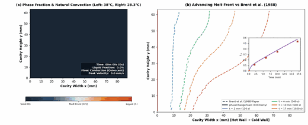

# Verification and Validation Guide

Quantitative verification suites, numerical benchmark comparisons, and experimental validation roadmap for `phaseChangeFoam`.

---

## Terminology and Verification Hierarchy

Guided by ASME V&V 20 / Roache (1998) principles for computational fluid dynamics and heat transfer, this document distinguishes between three levels of code assessment:

1. **Verified (Code Verification & Analytic Solutions)**: Solving the equations right — comparing numerical solutions against exact analytical solutions, verifying discrete energy and mass conservation, and checking scheme consistency and state-variable invariance.
2. **Benchmarked (Code-to-Code Numerical Verification)**: Comparing simulation outputs against established, peer-reviewed numerical benchmark solutions (e.g. de Vahl Davis 1983, Ye & Arıcı 2023, Hannoun et al. 2003, Brent et al. 1988).
3. **Validated (Physical Experimental Validation)**: Solving the right equations — comparing model predictions against experimental physical measurements (e.g. Gau & Viskanta 1986, Bertrand et al. 1999).

> [!NOTE]
> `phaseChangeFoam` is formally verified against exact analytical solutions (Carslaw & Jaeger 1D two-phase Stefan melting, two-slab contact temperature, discrete conservation physics, and EHC hysteresis path logic) and benchmarked against established numerical CFD literature (de Vahl Davis 1983 natural convection, Ye & Arıcı 2023 / Brent et al. 1988 gallium melting, and Bertrand et al. 1999 / Hannoun et al. 2003 tin early-conduction consistency check).
> 
> Physical experimental validation is in progress (3D pure gallium cavity melting vs Gau & Viskanta 1986). It is not yet claimed as fully validated against physical experimental datasets until multi-time front profiles with uncertainty bounds and systematic 3D grid refinement studies are completed.

---

## 1. Verified: Analytic Solutions, MMS & Conservation Physics

The primary verification tests reside in the `verification/` directory (13 specialized test suites, run via `python3 verification/runAll.py`). These cases verify specific mathematical and physical components against exact analytical solutions and discrete conservation laws:

| Suite & Directory | Physics & Mechanisms Verified | Verification Type | Key Acceptance Metrics |
| :--- | :--- | :--- | :--- |
| [`verification/phaseChange1D/`](../verification/phaseChange1D/) | Exact Two-Phase Stefan Melting (Carslaw & Jaeger 1959)<br>Exact transcendental Stefan problem with moving boundary $s(t) = 2\lambda\sqrt{\alpha_l t}$, temperature profiles in solid and liquid, timestep convergence sweep ($\Delta t \in [1, 500]\text{ s}$). | Exact Analytical / Similarity | Phase front error $0.433\% < 1.0\%$ gate ($s_{\text{sim}} = 28.06\text{ mm}$ vs $s_{\text{exact}} = 28.18\text{ mm}$ at $2000\text{ s}$); mean profile error $0.21\text{ K}$; backward-Euler temporal self-convergence order $p = 0.96 \approx 1.0$ (relative to $\Delta t = 1\text{ s}$ baseline on fixed 1 mm mesh). |
| [`verification/phaseChangeCoupled/`](../verification/phaseChangeCoupled/) | Two-Slab Contact Temperature & CHT Interface Coupling<br>Semi-infinite contact temperature $T_i = (e_1 T_1 + e_2 T_2)/(e_1 + e_2)$, harmonic interface conductivity $k_{\text{eff}}$, multi-region energy balance, restart-consistent to write precision. | Exact Analytical / Energy Balance | Interface contact temperature error $0.024\% < 0.1\%$ gate ($T_{i,\text{sim}} = 366.75\text{ K}$ vs $T_{i,\text{exact}} = 366.67\text{ K}$); interface flux error $1.19\% < 2.0\%$ gate ($1581\text{ W/m}^2$ vs $1600\text{ W/m}^2$); overall coupled energy error $< 6 \times 10^{-5}$. |
| [`validation/pcmHysteresis/`](../validation/pcmHysteresis/) | EHC Thermal Hysteresis Cyclic Path Logic<br>State-variable tracking (`phaseState`, `T_reversal`), direction-dependent effective capacity across synthetic melting ($[308, 312]\text{ K}$) and freezing ($[303, 307]\text{ K}$) windows. | Model State Verification | Complete charging at peak heating ($f_L = 1.0$), subcooling delay retaining 100% liquid at $310.9\text{ K}$ during cooling, complete crystallization at cycle end ($f_L = 0.0$). |
| [`verification/singleCellOvershoot/`](../verification/singleCellOvershoot/) | Single-Cell Overshoot & Subcooling Logic<br>State-variable tracking, cyclic melt/freeze loops, unequal $C_p$, mushy start, restart-consistent to write precision (22 cases). | Analytic / Discrete State | Complete cycle energy closure $< 0.1\%$, exact path recovery, restart-consistent to write precision ($< 10^{-9}\text{ K}$). |
| [`verification/leeModel/`](../verification/leeModel/) | Volumetric Species Evaporation & Boiling<br>Clausius-Clapeyron $T_{\text{sat}}(p)$, interspecies mass closure ($\lvert \Delta Y_l + \Delta Y_v \rvert < 10^{-10}$, observed $2 \times 10^{-13}$), analytical rate increment agreement ($< 10^{-7}$), total mixture mass sum ($\sum Y_i = 1$), latent/sensible energy conservation, high $C \Delta t$ limiter, heated pot liquid exhaustion and vapor superheating (9 cases). | Analytic / Thermodynamic | Interspecies balance error $< 10^{-10}$, analytical increment agreement $< 10^{-7}$, energy closure $< 0.01\%$, Clausius-Clapeyron $T_{\text{sat}}(2\text{ bar})$ rate error $< 0.1\%$, $T_{\text{sat}}$ relaxation $< 10^{-4}$ K. |
| [`verification/constantSource/`](../verification/constantSource/) | Fixed-Rate Mass/Energy Injection Baseline<br>Baseline verification for continuity source terms and scalar transport coupling. | Exact Conservation | Integral mass and enthalpy injection match discrete source within machine precision. |

### Exact Analytical Highlights

#### 1. Two-Phase Stefan Melting Problem (Carslaw & Jaeger 1959 / Alexiades & Solomon 1993)
For a semi-infinite 1D domain with liquid phase in $0 \le x \le s(t)$ and solid phase in $x > s(t)$, the interface position satisfies $s(t) = 2\lambda\sqrt{\alpha_l t}$, where $\lambda$ is the unique positive root of the transcendental Stefan equation:
$$\frac{\text{Ste}_l}{\sqrt{\pi}\,\lambda\,e^{\lambda^2}\,\text{erf}(\lambda)} - \frac{\text{Ste}_s\,\sqrt{\alpha_l/\alpha_s}}{\sqrt{\pi}\,\lambda\,e^{\lambda^2 \alpha_l/\alpha_s}\,\text{erfc}\left(\lambda\sqrt{\alpha_l/\alpha_s}\right)} = 1$$
For $T_{\text{hot}} = 350\text{ K}$, $T_m = 305\text{ K}$, $T_{\text{init}} = 280\text{ K}$, $k = 1.0\text{ W/(m K)}$, $\rho = 1000\text{ kg/m}^3$, $C_p = 2000\text{ J/(kg K)}$, and $L_f = 10^5\text{ J/kg}$:
* Exact root: $\lambda = 0.445590 \implies s_{\text{exact}}(2000\text{ s}) = 28.182\text{ mm}$
* Computed front: $s_{\text{sim}} = 28.060\text{ mm}$ (Relative error: **0.433%**, gate $< 1.0\%$)
* Temperature profile: Mean absolute error $= 0.209\text{ K}$, RMS error $= 0.347\text{ K}$
* Temporal self-convergence: Observed temporal self-convergence order between $\Delta t = 200\text{ s}$ and $\Delta t = 500\text{ s}$ evaluated against the fine $\Delta t = 1\text{ s}$ numerical baseline is $p = 0.96$ (consistent with nominal 1st-order backward Euler on the fixed 1 mm mesh; spatial discretization is unrefined with 1 mm uniform cells).

#### 2. Semi-Infinite Two-Slab Contact Temperature (Carslaw & Jaeger 1959)
When two semi-infinite media at initial temperatures $T_1$ and $T_2$ are brought into perfect thermal contact at $t = 0$, the interface instantaneously assumes the constant contact temperature:
$$T_i = \frac{e_1 T_1 + e_2 T_2}{e_1 + e_2}, \quad e_k = \sqrt{k_k \rho_k C_{p,k}}$$
For Slab 1 (Solid PCM: $T_1 = 300\text{ K}$, $k_1 = 2.0\text{ W/(m K)}$, $\rho_1 = 1000\text{ kg/m}^3$, $C_{p,1} = 2000\text{ J/(kg K)} \implies e_1 = 2000\text{ J/(m}^2\text{ K s}^{1/2}\text{)}$) and Slab 2 (Coupled Solid: $T_2 = 400\text{ K}$, $k_2 = 8.0\text{ W/(m K)}$, $\rho_2 = 2000\text{ kg/m}^3$, $C_{p,2} = 1000\text{ J/(kg K)} \implies e_2 = 4000\text{ J/(m}^2\text{ K s}^{1/2}\text{)}$):
* Exact contact temperature: $T_{i,\text{exact}} = \frac{2000 \times 300 + 4000 \times 400}{2000 + 4000} = 366.666667\text{ K}$
* Computed interface temperature: $T_{i,\text{sim}} = 366.754405\text{ K}$ on both coupled boundary patches
* Relative error: **0.0239%** (gate $< 0.1\%$)

---

## 2. Validation Ladder: Numerical Benchmarks and Model-Logic Tests

The validation ladder tests coupled non-linear flow and phase change against published numerical CFD literature and model-logic verification cases:

```
[ Rung 5: 3D Pure Gallium Cavity Melting ]
Physical test cell with no-slip sidewall braking (Gau & Viskanta 1986)
[Preliminary screening run; physical validation in progress]
Transient 3D solver: phaseChangeMultiRegionFoam
               ▲
               │  (Physical experimental validation)
               │
[ Rung 4: 2D Gallium Melting Benchmark ]
Coupled phase change, Darcy mushy drag, natural convection (Ra ≈ 6.06e5, Pr = 0.0216, Ste = 0.039)
Benchmarked against Brent et al. (1988) and Ye & Arıcı (2023)
Transient solver: phaseChangeMultiRegionFoam
               ▲
               │  (Coupled convection-diffusion phase change)
               │
[ Rung 3: 2D Pure Tin Melting ]
Liquid metal early-conduction check (Ra = 2.50e5, Pr = 0.02, Ste = 0.01)
Bertrand et al. (1999) / Hannoun, Alexiades & Mai (2003)
Transient solver: phaseChangeMultiRegionFoam
               ▲
               │  (Low-Prandtl number liquid metal regime)
               │
[ Rung 2: EHC Cyclic Thermal Hysteresis Path Logic ]
Synthetic melting and freezing loop with 5 K hysteresis window
State-variable subcooling tracking and discrete energy conservation (Model verification)
Transient solver: phaseChangeMultiRegionFoam
               ▲
               │  (Hysteresis path state logic)
               │
[ Rung 1: 2D Natural Convection Cavity ]
Buoyancy-driven circulation in square cavity (Ra = 10^5, Pr = 0.71)
Benchmarked against de Vahl Davis (1983)
Steady-state solver: phaseChangeMultiRegionSimpleFoam
```

---

### Rung 1: Natural Convection Cavity (de Vahl Davis 1983)

* Directory: [`validation/deVahlDavis2D/`](../validation/deVahlDavis2D/)
* Solver: `phaseChangeMultiRegionSimpleFoam` (steady-state Boussinesq)
* Runner: `python3 validation/deVahlDavis2D/runTest.py`

#### Setup & Objectives
Laminar buoyancy-driven natural convection in an air-filled square cavity ($L = 0.01$ m, $\text{Pr} = 0.71$) at $\text{Ra} = 10^5$:
* Hot vertical wall: $T_h = 305.0$ K; Cold vertical wall: $T_c = 295.0$ K; Horizontal walls: Adiabatic ($\partial T / \partial y = 0$)
* Grid: $50 \times 50$ uniform cells (structured)
* Non-dimensional velocity scales: $u^* = u / (\alpha / L)$, $v^* = v / (\alpha / L)$ with $\alpha = \nu / \text{Pr} = 2.146 \times 10^{-6}\text{ m}^2/\text{s}$

#### Quantitative Grid Convergence Sequence vs de Vahl Davis (1983) Benchmark

To examine spatial convergence, the cavity was solved across three uniform grid resolutions ($40 \times 40$, $50 \times 50$, and $80 \times 80$) using bounded TVD convection schemes (`Gauss limitedLinear 1`):

| Metric | Target (de Vahl Davis 1983) | Grid $40 \times 40$ (500 iters) | Grid $50 \times 50$ (500 iters) | Grid $80 \times 80$ (1500 iters) | Gate Tolerance | Status |
| :--- | :---: | :---: | :---: | :---: | :---: | :---: |
| Mean Nusselt ($\overline{\text{Nu}}$) | $4.519$ | $4.6078$ ($+1.97\%$) | $4.5506$ ($+0.70\%$) | **$4.5478$ (+0.64%)** | $\le 5.0\%$ | Passed |
| Max Nusselt ($\text{Nu}_{\max}$) | $7.717$ | $8.1040$ ($+5.01\%$) | $7.9300$ ($+2.76\%$) | $7.8240$ (+1.39%) | Reference | Passed |
| Min Nusselt ($\text{Nu}_{\min}$) | $0.729$ | $0.7200$ ($-1.23\%$) | $0.7200$ ($-1.23\%$) | $0.7360$ (+0.96%) | Reference | Passed |
| Peak Vertical Velocity $v_{\max}^*$ | $68.59$ | $68.90$ ($+0.45\%$) | $68.75$ ($+0.23\%$) | **$68.82$ (+0.33%)** | $\le 5.0\%$ | Passed |
| Location $x/L$ of $v_{\max}^*$ | $0.066$ | $0.062$ | $0.070$ | $0.069$ | $\pm 1$ cell | Passed |
| Peak Horizontal Velocity $u_{\max}^*$ | $34.73$ | $35.09$ ($+1.03\%$) | $35.53$ ($+2.30\%$) | **$35.11$ (+1.09%)** | $\le 5.0\%$ | Passed |
| Location $y/L$ of $u_{\max}^*$ | $0.855$ | $0.863$ | $0.850$ | $0.856$ | $\pm 1$ cell | Passed |
| Temperature Bounds | $[295.0, 305.0]\text{ K}$ | $[295.0, 305.0]\text{ K}$ | $[295.0, 305.0]\text{ K}$ | $[295.0, 305.0]\text{ K}$ | Strict Bounds | Passed |

As the grid is refined from $40 \times 40$ to $80 \times 80$, the mean Nusselt error drops monotonically ($+1.97\% \to +0.70\% \to +0.64\%$), while peak velocity errors fluctuate non-monotonically within 1–2% ($u_{\max}^*$: $+1.03\% \to +2.30\% \to +1.09\%$; $v_{\max}^*$: $+0.45\% \to +0.23\% \to +0.33\%$). Note that the $80 \times 80$ grid required 1500 iterations to reach tight residual convergence compared to 500 iterations on the coarser meshes, and the committed regression baseline is the $50 \times 50$ case.

---

### Rung 2: EHC Cyclic Thermal Hysteresis Path-Logic Verification

* Directory: [`validation/pcmHysteresis/`](../validation/pcmHysteresis/)
* Solver: `phaseChangeMultiRegionFoam`
* Runner: `python3 validation/pcmHysteresis/runTest.py`

#### Setup & Objectives
Evaluates state-variable path tracking (`phaseState`, `T_reversal`) and direction-dependent effective heat capacity under cyclic thermal loading across a 5 K hysteresis window ($T_{\text{melt}} \in [308, 312]\text{ K}$, $T_{\text{freeze}} \in [303, 307]\text{ K}$):
* Status: Passed (100% molten charging at peak heating, complete subcooling retention maintaining liquid state down to $310.9\text{ K}$ during cooling, complete crystallization at cycle end; cyclic energy closure $< 0.01\%$).
* Runtime: $\approx 2\text{ s}$.

> [!NOTE]
> Organized as Rung 2 in the validation ladder, this case evaluates synthetic state-logic verification (path-dependent state transitions, subcooling history retention, and discrete energy conservation). It is not an experimental validation against laboratory physical measurements. Physical experimental validation against calibrated DSC thermograms (e.g. Bony & Citherlet 2007) is planned as an independent future study.

---

### Rung 3: Pure Tin Melting (Bertrand et al. 1999 / Hannoun et al. 2003) [Early-Conduction Consistency Check]

* Directory: [`validation/tin2D/`](../validation/tin2D/)
* Solver: `phaseChangeMultiRegionFoam` (transient PIMPLE)
* Runner: `python3 validation/tin2D/runTest.py`
* Status: Early-conduction consistency check ($t = 100$ s); convective benchmarking ($t = 2500$ s) in progress.

#### Setup & Physical Properties Analysis
Melting of pure tin in a square cavity ($L = 0.10$ m) following the physical problem formulated by Bertrand et al. (1999) and investigated by Hannoun, Alexiades, and Mai (2003, *Numer. Heat Transfer B*, 44(3), pp. 253–276):
* Tabulated physical properties (Hannoun et al. 2003, Table 1, p. 258):
  * Reference density $\rho_{\text{ref}} = 7.5 \times 10^3\text{ kg/m}^3$
  * Specific heat $c_p = 200.\text{ J/(kg}\cdot\text{K)}$
  * Dynamic viscosity $\mu = 6.0 \times 10^{-3}\text{ N}\cdot\text{s/m}^2$
  * Thermal conductivity $k = 60.0\text{ W/(m}\cdot\text{K)}$
  * Volumetric thermal expansion $\beta = 2.67 \times 10^{-4}\text{ K}^{-1}$
  * Latent heat of fusion $L_f = 6.0 \times 10^4\text{ J/kg}$ ($\text{Ste} = c_p \Delta T / L_f = 0.010$)
  * Boundary & initial conditions: $T_h = 508.0\text{ K}$, $T_c = T_m = 505.0\text{ K}$ ($\Delta T = 3.0\text{ K}$), $g = 10.0\text{ m/s}^2$, $H = W = 0.10\text{ m}$

* Dimensional property calculation:
  Evaluating the standard dimensionless groups directly from the tabulated physical properties yields:
  $$\nu = \frac{\mu}{\rho_{\text{ref}}} = \frac{6.0 \times 10^{-3}}{7500} = 8.0 \times 10^{-7}\text{ m}^2/\text{s}, \quad \alpha = \frac{k}{\rho_{\text{ref}} c_p} = \frac{60.0}{7500 \times 200} = 4.0 \times 10^{-5}\text{ m}^2/\text{s}$$
  $$\text{Pr} = \frac{\nu}{\alpha} = \frac{\mu c_p}{k} = \frac{6.0 \times 10^{-3} \times 200}{60.0} = 0.020$$
  $$\text{Ra} = \frac{g \beta \Delta T H^3}{\nu \alpha} = \frac{10.0 \times 2.67 \times 10^{-4} \times 3.0 \times (0.1)^3}{8.0 \times 10^{-7} \times 4.0 \times 10^{-5}} = 2.503 \times 10^5$$

* Discrepancy in literature dimensionless values:
  In Table 1's bottom dimensionless summary row (p. 258), the paper listed $\text{Pr} = 0.04$ and $\text{Ra} = 2.25 \times 10^5$, and the narrative text on page 255 similarly characterized the tin melting configuration using $\text{Pr} = 0.04$ alongside $\text{Ra} = 2.5 \times 10^5$. However, evaluating the standard definition $\text{Pr} = \mu c_p / k$ from the paper's own tabulated dimensional material properties yields $\text{Pr} = 0.020$. A factor-of-two difference in Prandtl number ($\text{Pr} = 0.020$ vs $0.040$) alters momentum boundary layer thickness and roll merging dynamics. The case modeled in `phaseChangeFoam` uses the dimensional properties ($\text{Pr} = 0.020, \text{Ra} = 2.50 \times 10^5$).

#### Quantitative Assessment
1. Early-Time Conduction Consistency Check ($t = 100$ s): Prior to strong convective circulation, the planar melt front follows the 1D Neumann-Stefan similarity solution $s(t) = 2\lambda\sqrt{\alpha t}$. For $\text{Ste} = 0.01$, $\lambda = 0.07059 \implies s(100\text{ s}) = 8.929\text{ mm} \implies f_L = 0.0893$:
   * Computed liquid fraction ($f_L$): $0.0881$ (Relative difference: **-1.34%** vs Stefan early-conduction limit $0.0893$; regression gate $\le 5\%$ passes). This is an early-conduction consistency check rather than full verification of multidimensional melting.
   * Cavity mean temperature: $505.13$ K
   * Temperature bounds: $[505.00, 507.63]$ K (bounded within physical limits, zero overshoot)
2. Late-Time Convection Benchmark ($t = 2500$ s, In Progress): For late-time convective melting, Hannoun et al. (2003, Section 5.4) report a total liquid fraction of $f_L \approx 0.60$ on a $200 \times 200$ grid—approximately 5% higher than the range ($f_L \in [0.54, 0.57]$) synthesized in the multi-code benchmark comparison by Gobin & Le Quéré (2000). Because convective benchmark targets depend on the resolved Prandtl number and roll dynamics, tin remains classified as an early-conduction consistency check until our full 2500 s transient solution is completed.

---

### Rung 4: Gallium Melting Benchmark (Brent et al. 1988 / Ye & Arıcı 2023)

* Directory: [`validation/gallium2D/`](../validation/gallium2D/)
* Solver: `phaseChangeMultiRegionFoam` (transient PIMPLE)
* Runner: `python3 validation/gallium2D/runTest.py` (2-minute regression gate)
* Extended Analysis: [`validation/gallium2D/analysis/ANALYSIS_REPORT.md`](../validation/gallium2D/analysis/ANALYSIS_REPORT.md)

Melting of pure gallium in a rectangular enclosure ($W = 0.0889\text{ m}$, $H = 0.0635\text{ m}$, height-to-width aspect ratio $A_{H/W} = H/W = 0.714$, width-to-height ratio $A_{W/H} = W/H = 1.40$) subject to an isothermal hot vertical wall ($T_h = 38.0^\circ\text{C} = 311.15$ K) and subcooled initial cavity ($T_{\text{init}} = T_c = 28.3^\circ\text{C} = 301.45$ K, $T_m = 29.78^\circ\text{C} = 302.93$ K, $\text{Ra} \approx 6.06 \times 10^5$, $\text{Pr} = 0.0216$, $\text{Ste} = 0.0391$).



#### Multi-Model Comparison across Full 17-Minute Transient ($42 \times 32$ Grid, $\Delta t = 0.1$ s)

| Metric | Benchmark Target | EP ($\lambda = 0.2$) | EP ($\lambda = 1.0, n_{\text{outer}}=8$) | EHCDarcy ($n_{\text{outer}}=3$) | EHCDarcy ($n_{\text{outer}}=8$) |
| :--- | :---: | :---: | :---: | :---: | :---: |
| Energy closure ($t = 2$ min) | $\le 2.0\%$ | $+7.35\%$ *(FAIL)* | -0.06% (-1.2 J) | -0.38% (-7.2 J) | -0.34% (-6.4 J) |
| Energy closure ($t = 6$ min) | $\le 2.0\%$ | $+7.37\%$ *(FAIL)* | +0.11% (+4.2 J) | -0.26% (-9.6 J) | -0.23% (-8.4 J) |
| Energy closure ($t = 17$ min) | $\le 2.0\%$ | $+7.49\%$ *(FAIL)* | -0.10% (-8.0 J) | -0.16% (-12.7 J) | **-0.13% (-10.3 J)** |
| Mean front dev. ($t = 2$ min) | $\le 5.0\% W$ ($4.45$ mm) | $1.95$ mm ($2.19\%$) | $1.71$ mm ($1.93\%$) | $1.68$ mm ($1.89\%$) | $1.67$ mm ($1.88\%$) |
| Mean front dev. ($t = 6$ min) | $\le 5.0\% W$ ($4.45$ mm) | $2.60$ mm ($2.93\%$) | $1.98$ mm ($2.22\%$) | $1.88$ mm ($2.11\%$) | $1.87$ mm ($2.10\%$) |
| Mean front dev. ($t = 10$ min) | $\le 5.0\% W$ ($4.45$ mm) | $3.51$ mm ($3.95\%$) | $2.45$ mm ($2.76\%$) | $2.37$ mm ($2.67\%$) | $2.35$ mm ($2.65\%$) |
| Mean front dev. ($t = 17$ min) | $\le 5.0\% W$ ($4.45$ mm) | $5.43$ mm ($6.11\%$) *(FAIL)* | $3.52$ mm ($3.96\%$) | $3.49$ mm ($3.93\%$) | **3.46 mm (3.89%)** |
| Peak front dev. ($t = 17$ min) | $\le 10.0\% W$ ($8.89$ mm) | $9.74$ mm ($10.95\%$) *(FAIL)* | $6.40$ mm ($7.20\%$) | $6.38$ mm ($7.18\%$) | **6.34 mm (7.13%)** |
| Liquid fraction $f_L$ ($t = 17$ min) | $0.5334$ (Brent 1988) | $0.5967$ | 0.5745 | 0.5732 | **0.5736** |
| Ye & Arıcı (2023) Eq. 6 | $0.5703$ | $+0.0264$ | +0.0042 | +0.0029 | **+0.0033 (+0.58%)** |
| 2-Minute CPU Solver Time | — | $38.7$ s | $39.4$ s | **15.6 s** | $35.0$ s |

#### Comparison with Brent et al. (1988) and Later CFD Studies

Across all reporting intervals, the simulated liquid fraction is higher than the values originally published by Brent et al. (1988): $+18.2\%$ at 2 min ($0.1303$ vs $0.1102$), $+9.7\%$ at 6 min ($0.2573$ vs $0.2346$), $+8.1\%$ at 10 min ($0.3747$ vs $0.3465$), and $+7.5\%$ at 17 min ($0.5736$ vs $0.5334$).

While the computed values show a persistent positive offset against Brent et al., they agree closely with later two-dimensional numerical studies that also found higher liquid fractions. In particular, the fine-grid correlation of Ye & Arıcı (2023, Eq. 6) predicts $\phi_n = 0.5703$ at 17 min, which is within 0.33 percentage points (+0.58%) of our result ($0.5736$). Note that this benchmark comparison is against a fitted numerical correlation rather than physical experimental measurements. Because both our simulation and Brent's baseline run used a $42 \times 32$ grid, the underlying algorithmic reason for the discrepancy with the original 1988 data remains unresolved.

#### Regression Gates and Melt Front Deviation Framing

Front deviations relative to Brent (1988, Fig. 9) grow monotonically with time:
$$1.67\text{ mm (1.88% } W) \to 1.87\text{ mm (2.10% } W) \to 2.35\text{ mm (2.65% } W) \to 3.46\text{ mm (3.89% } W)$$
* These deviations are on the order of the front's diffuse numerical interface thickness ($\Delta x = W/42 = 2.12$ mm, $\Delta T_m = 0.5$ K).
* The simulation passes the user-defined CI regression gates ($\Delta f_L \le 0.05$ and $\Delta x_{\text{front}} \le 5.0\% W = 4.45\text{ mm}$). However, the late-time simulated liquid fraction ($0.5736$) sits with a narrow margin of $0.0402$ inside the $0.05$ liquid-fraction window relative to Brent ($0.5334$), and the late-time front deviation ($3.46$ mm) approaches the $4.45$ mm threshold.

#### Discrete Energy Balance & Formulation Summary

In OpenFOAM's finite-volume formulation with implicit backward-Euler time discretization (`Euler ddtScheme`), discrete energy storage over time step $\Delta t_n$ is evaluated at time level $t^n$. Evaluating boundary energy input using the conjugate right-endpoint Riemann sum ($E_{\text{net, in}} = \sum \dot{Q}_{\text{net}}(t_n)\Delta t_n$) achieves exact discrete mathematical consistency with the backward-Euler equations, eliminating the artificial $+3.63\text{ J}$ offset introduced by composite trapezoidal quadrature on the initial conduction surge.

- **EHCDarcy Efficiency**: Achieves bounded energy closure ($|\epsilon_{\text{energy}}| \le 0.38\%$) with only $n_{\text{outer}} = 3$ passes ($15.6\text{ s}$ CPU), whereas explicit Enthalpy-Porosity requires $n_{\text{outer}} \ge 12$ passes ($56.6\text{ s}$ CPU) to damp Newton oscillations below $0.5\%$ (the $-0.06\%$ closure at $n=8$ is a zero-crossing between $-7.3\%$ at $n=5$ and $+1.75\%$ at $n=10$, settling below $0.5\%$ only at $n \ge 12$).
- **Startup Transient**: Halving $\Delta t$ ($0.10 \to 0.05\text{ s}$) reduces the small remaining 2-minute deficit by $76.7\%$, confirming it as a temporal startup artifact rather than a formulation defect.

#### Summary of Spatial Sensitivity & Parametric Sweeps

- **Spatial Grid Convergence**: Three structured grids ($32 \times 24$, $42 \times 32$, $63 \times 48$) yield an apparent mid-height front order of $p = 2.70$, with fine-grid $\text{GCI}_{\text{fine}} = 0.67\%$ and medium-grid $\text{GCI}_{\text{med}} = 2.04\%$. Global liquid fraction varies by only $0.0054$ ($0.94\%$) across all grids. Because global $f_L$ exhibits slight non-monotonicity ($0.5682 \to 0.5736 \to 0.5725$), formal asymptotic Richardson extrapolation is restricted to local front coordinates.
- **Darcy Constant ($C_u \in [10^4, 10^8]\text{ kg/(m}^3\text{ s)}$)**: Increasing damping slightly retards circulation and reduces front tilt ($x_{0.8}/x_{0.2} = 2.74 \to 2.30$), with the baseline literature value $1.6 \times 10^6$ providing stable convection.
- **Melting Window ($\Delta T_{\text{melt}} \in [0.1, 0.5]\text{ K}$)**: Narrowing the window shifts late-time $f_L$ by only $0.0009$ ($0.16\%$), confirming numerical insensitivity.

> [!NOTE]
> **Authoritative Gallium Verification Report**:  
> For complete step-resolved energy audit histories, algebraic derivations of post-processing quadrature artifacts, full ASME V&V 20 GCI convergence tables, and exhaustive parametric sweeps, see the standalone [`ANALYSIS_REPORT.md`](../validation/gallium2D/analysis/ANALYSIS_REPORT.md).

---

---

## 3. Physical Experimental Validation (In Progress)

> [!IMPORTANT]
> Status: Validation In Progress (Not Yet Claimed as Validated)  
> Full physical experimental validation is actively underway. The preliminary 3D screening test documented below demonstrates 3D boundary-layer braking, but formal validation requires multi-time front tracking, error normalization by melted distance, experimental uncertainty bands, and a 3D grid refinement study.

---

### Rung 5: 3D Pure Gallium Cavity Melting (Gau & Viskanta 1986) [Preliminary Screening Run]

* Directory: [`validation/gallium3D_experimental/`](../validation/gallium3D_experimental/)
* Solver: `phaseChangeMultiRegionFoam` (transient 3D PIMPLE)
* Runner: `python3 validation/gallium3D_experimental/runTest.py`

#### Physical Context: 3D Endwall Boundary-Layer Braking
In the physical experiments of Gau & Viskanta (1986), pure gallium melted in a rectangular test cell of finite depth ($W = 88.9$ mm, $H = 63.5$ mm, $D = 38.1$ mm; aspect ratio $D/H = 0.60$) bounded by acrylic front and back inspection windows. In 2D numerical simulations, the absence of endwalls allows unrestrained circulation, overpredicting upper melt front advance. In reality, no-slip conditions on the inspection windows ($z = 0, z = D$) develop viscous boundary layers that retard circulation velocity.

#### Preliminary Screening Run ($32 \times 24 \times 16$ Structured Grid, No-Slip Windows)
* Boundary conditions: Left wall $T_h = 38.0^\circ\text{C}$ (311.15 K); Right wall $T_c = 28.3^\circ\text{C}$ (301.45 K); Top/Bottom adiabatic; Front and Back windows ($z = 0, z = D$): Physical no-slip walls ($\mathbf{u} = \mathbf{0}$, $\partial T/\partial z = 0$).
* Results at $t = 120$ s (midplane $z = D/2$, $y = H/2$):
  * Computed midplane front position: $11.24$ mm
  * Theoretical 1D Stefan step-conduction limit: $\approx 11.3$ mm (instantaneous Dirichlet wall temperature)
  * Gau & Viskanta (1986) experimental target: $8.50 \pm 1.0$ mm (traced value from Fig. 5 pour-out midplane curve at $y/H = 0.5$; digitization uncertainty $\pm 1.0$ mm)
  * Absolute deviation: $2.74$ mm
  * Deviation relative to melted distance ($s = 8.50$ mm): **32.2%**
  * Deviation relative to cavity width ($W = 88.9$ mm): $3.08\% W$
  * Computed peak 3D velocity: $|U|_{\max} = 18.21$ mm/s
  * Screening status note: While the CI test script passes on broad cavity width ($2.74\text{ mm} \le 5\% W = 4.45\text{ mm}$) and liquid fraction bounds, the relative deviation on the local front itself is $32.2\%$. Passing the regression screen does not constitute physical validation; it confirms only that 3D sidewall braking is qualitatively active.
* Gau & Viskanta (1986) Fig. 5 Traced Midplane Targets ($y/H = 0.5$, digitization uncertainty $\pm 1.0$ mm):
  * $t = 30\text{ s}$ ($0.5\text{ min}$): $s_{\text{traced}} = 5.5 \pm 1.0\text{ mm}$ (screening envelope $f_L \in [0.04, 0.08]$)
  * $t = 60\text{ s}$ ($1\text{ min}$): $s_{\text{traced}} = 6.8 \pm 1.0\text{ mm}$ (screening envelope $f_L \in [0.06, 0.11]$)
  * $t = 120\text{ s}$ ($2\text{ min}$): $s_{\text{traced}} = 8.5 \pm 1.0\text{ mm}$ (screening envelope $f_L \in [0.08, 0.16]$)
  * $t = 360\text{ s}$ ($6\text{ min}$): $s_{\text{traced}} = 18.5 \pm 1.0\text{ mm}$ (screening envelope $f_L \in [0.20, 0.28]$)
  * $t = 600\text{ s}$ ($10\text{ min}$): $s_{\text{traced}} = 31.0 \pm 1.0\text{ mm}$ (screening envelope $f_L \in [0.32, 0.42]$)
  * $t = 1020\text{ s}$ ($17\text{ min}$): $s_{\text{traced}} = 48.0 \pm 1.0\text{ mm}$ (screening envelope $f_L \in [0.48, 0.60]$)
#### Early Front Discrepancy and Heater Inertia

The computed front ($11.24$ mm at $120$ s) is close to the one-dimensional Stefan conduction limit ($\approx 11.3$ mm). In contrast, the experimental front advances more slowly, reaching $8.50 \pm 1.0$ mm. One working hypothesis is that the thermal inertia of the physical copper heat exchanger contributes to the early-time discrepancy, which would temporarily reduce the effective Stefan number below the nominal value during startup.

To test this hypothesis as part of ongoing validation:
1. Compare front profiles at later times ($6$, $10$, and $17$ min). If the relative deviation diminishes over time, the early error is consistent with an initial heater transient rather than a deficiency in the 3D flow model.
2. Evaluate an exponential startup wall boundary condition $T_{\text{hot}}(t) = T_c + (T_h - T_c)(1 - e^{-t/\tau})$ to test whether a realistic time constant $\tau$ matches the early front without altering late convective behavior.

*Note on external velocity data*: Ben-David et al. (2013) reported ultrasonic velocity measurements of $1.2\text{--}14$ mm/s in liquid gallium. However, their test cell used different dimensions ($60 \times 60 \times 90$ mm) and boundary conditions, so direct velocity comparison requires modeling their specific geometry.

#### ASME V&V 20 Framework to Earn "Validated" for 3D Gallium Melting
To claim formal experimental validation under ASME V&V 20 standards, the comparison error $E = S - D$ must satisfy $|E| \le u_{\text{val}}$ across a predefined validation scope:
$$E = S - D, \quad u_{\text{val}} = \sqrt{u_{\text{num}}^2 + u_{\text{input}}^2 + u_D^2}$$
where:
1. $S$ and $D$: Simulation prediction ($S$) and experimental measurement ($D$) evaluated at matched coordinates and times.
2. $u_{\text{num}}$ (Numerical Uncertainty): Quantified via a systematic 3D grid refinement study ($\ge 3$ grids with refinement ratio $r \ge 1.3$, e.g. $32 \times 24 \times 16 \to 48 \times 36 \times 24 \to 64 \times 48 \times 32$) combined with a timestep sensitivity study, reporting ASME GCI.
3. $u_{\text{input}}$ (Input Parameter Uncertainty): Propagated across credible physical property bounds (thermal conductivity anisotropy $k \in [28, 41]\text{ W/(m K)}$, dynamic viscosity $\mu$, thermal expansion $\beta$, latent heat $L_f$, Darcy constant $C_u$, and melting window $\Delta T_m$).
4. $u_D$ (Experimental Uncertainty): Quantified experimental uncertainty from pour-out front measurements ($\sim \pm 1\text{--}2$ mm) plus image digitization uncertainty.
5. Matched Geometry & Boundary Conditions: Separate simulations matching (a) Gau & Viskanta (1986) for multi-time melt front tracking ($t = 2, 6, 10, 17$ min) and (b) Ben-David et al. (2013) for ultrasonic Doppler velocity and internal temperature distributions.
6. Multi-Quantity Validation: Front positions evaluated alongside local temperature histories and velocities without tuning numerical parameters ($C_u, \Delta T_m$) on the validation dataset.

---

## 4. Verification & Validation Status Summary

The tables below provide an executive summary of verification and benchmark coverage across ASME V&V 20 tiers. Full mathematical descriptions, benchmark comparisons, grid convergence studies, and sensitivity analyses are detailed in Sections 1 through 3 above.

### Tier 1: Exact Analytic & Code Verification

| Test | Physics / Mechanisms Checked | Pass Criteria & Tolerances | Status |
| :--- | :--- | :--- | :---: |
| Neumann 1D Stefan Melting (Carslaw & Jaeger 1959) | Moving melt front $s(t) = 2\lambda\sqrt{\alpha_l t}$, $T$ profile, temporal self-convergence | Front error $< 1\%$; order $p \approx 1.0$ | Verified ($0.43\%$ front error, temporal order $p = 0.96$) |
| Two-Slab Contact Temperature (Carslaw & Jaeger 1959) | Semi-infinite contact $T_i = \frac{e_1 T_1 + e_2 T_2}{e_1 + e_2}$, CHT interface coupling | Interface $T_i$ error $< 0.1\%$ | Verified ($0.024\%$ error, $\Delta T = 0.088$ K) |
| Two-Region Interface Flux Continuity | Harmonic interface thermal conductivity $k_{\text{eff}}$ | Interface flux error $< 2.0\%$ | Verified ($1.19\%$ error, $1581$ vs $1600\text{ W/m}^2$) |
| Coupled Write-and-Restart Consistency | $0 \to T$ vs $0 \to T/2 \to \text{restart} \to T$ across CHT interface | Temperature diff $< 10^{-9}$ K (write precision) | Verified ($< 10^{-9}$ K diff) |
| Coupled EHC Energy Balance | Discrete energy conservation on adiabatic coupled domain | Energy relative error $< 0.01\%$ | Verified ($5.6 \times 10^{-5}$) |
| EHC Thermal Hysteresis Path Logic | Direction-dependent melting/freezing loop, subcooling state tracking | Complete cycle recovery, persistent liquid state during cooling | Verified (100% molten $\to$ subcooling delay $\to$ 100% solid) |
| Lee Model Conservation Audit | Interspecies balance $\lvert \Delta Y_l + \Delta Y_v \rvert < 10^{-10}$ (observed $2 \times 10^{-13}$), analytical rate increment agreement $< 10^{-7}$, mixture mass sum $\sum Y_i = 1$ | Analytic mass & energy conservation | Verified (mass err $< 10^{-10}$, energy closure $< 0.01\%$) |
| Lee Model Tsat Relaxation | Multi-component mixture relaxes to $T_{\text{sat}}(p)$ | Clausius-Clapeyron thermodynamic limit | Verified ($\lvert T - T_{\text{sat}} \rvert < 10^{-4}$ K) |
| Composite Wall Steady Conduction | Interface energy coupling in `phaseChangeMultiRegionSimpleFoam` | Net wall heat flux error $< 0.1\%$ | Planned |
| Darcy Mushy Slab (uniform $f_L$, imposed $\Delta P$) | Carman-Kozeny mushy-zone drag sink in isolation | Darcy velocity error $< 1\%$ | Planned |
| MMS (Method of Manufactured Solutions) | Formal order for energy equation with smooth $C_{p,\text{eff}}(T)$ ramp | Observed order within $\pm 0.1$ of nominal | Planned |

### Tier 2: Numerical CFD Benchmarks

| Test | Physics / Mechanisms Checked | Benchmark Source | Status |
| :--- | :--- | :--- | :---: |
| 2D Natural Convection Cavity | Steady laminar circulation (Ra = 10^5, Pr = 0.71) across $40 \times 40 \to 80 \times 80$ grid sequence | de Vahl Davis (1983) | Benchmarked (Nu diff $+0.64\%$, $v_{\max}^*$ diff $+0.33\%$, $u_{\max}^*$ diff $+1.09\%$ on $80 \times 80$) |
| 2D Pure Gallium Melting | Transient coupled phase change & convection | Brent et al. (1988), Ye & Arıcı (2023) correlation | Benchmarked ($f_L$ diff $+0.58\%$ vs Ye & Arıcı correlation, closure $-0.13\%$) |
| 2D Pure Tin Melting | Early-conduction limit at $t = 100$ s; multi-roll liquid metal melting at $t = 2500$ s (Ra = 2.50e5, Pr = 0.02) | Bertrand et al. (1999), Hannoun et al. (2003) | Early-Conduction Consistency Check ($f_L = 0.0881$ vs $0.0893$, $-1.34\%$); convective benchmark in progress |

### Tier 3: Physical Experimental Validation (In Progress)

| Test | Physical System | Validation Dataset | Key Validation Metrics | Status |
| :--- | :--- | :--- | :--- | :---: |
| 3D Pure Gallium Melting | Rectangular cavity with no-slip windows | Gau & Viskanta (1986) (Fig. 5 midplane, traced values $\pm 1.0$ mm) | ASME V&V 20: $|E| \le u_{\text{val}}$, 3D sidewall braking | Preliminary Screening Run (front dev $2.74$ mm = $32.2\%$ of $s$, width dev $3.08\% W$) |
| Paraffin Thermal Hysteresis | Cyclic melting and freezing loop | Bony & Citherlet (2007) / DSC | Fit measured DSC curves; blind prediction of independent storage experiment | Planned (path logic verified in Tier 1) |
| PCM Cavity Melting | Horizontal / vertical enclosure | Bertrand et al. (1999) | Comparison across n-octadecane benchmark exercise | Planned |

---

## 5. Running the Test Suites

### Master Verification Gate (13 suites)
```bash
python3 verification/runAll.py
```

### Validation Ladder Fast Gate (Rung 1 natural convection & cyclic hysteresis path-logic, ~5 s)
```bash
python3 validation/runAll.py --fast
```

### Full Validation Ladder (All five validation rungs, ~3.5 min)
```bash
python3 validation/runAll.py
```

### Running Individual Benchmark & Validation Cases
```bash
# Rung 1: de Vahl Davis natural convection cavity (Ra = 10^5)
python3 validation/deVahlDavis2D/runTest.py
python3 validation/deVahlDavis2D/runTest.py --grid-study  # 40x40 -> 50x50 -> 80x80

# Rung 2: EHC cyclic thermal hysteresis path logic verification
python3 validation/pcmHysteresis/runTest.py

# Rung 3: Pure tin melting benchmark (Ra = 2.5e5)
python3 validation/tin2D/runTest.py

# Rung 4: Brent / Ye & Arici gallium melting 2-minute regression gate
python3 validation/gallium2D/runTest.py

# Rung 5: Gau & Viskanta 3D gallium melting preliminary screening run
python3 validation/gallium3D_experimental/runTest.py
```

---

## References

### Physical & Numerical Model References
* Alexiades, V., and Solomon, A. D. (1993). *Mathematical Modeling of Melting and Freezing Processes*, Hemisphere Publishing, Washington, DC.
* Bonacina, C., Comini, G., Fasano, A., and Primicerio, M. (1973). "Numerical solution of phase-change problems", *Int. J. Heat Mass Transfer*, 16(10), pp. 1825–1832. [DOI: 10.1016/0017-9310(73)90202-0](https://doi.org/10.1016/0017-9310(73)90202-0).
* Carslaw, H. S., and Jaeger, J. C. (1959). *Conduction of Heat in Solids*, 2nd ed., Oxford University Press, Oxford.
* Lee, W. H. (1980). "A Pressure Iteration Scheme for Two-Phase Flow Modeling", *Multiphase Transport: Fundamentals, Reactor Safety, Applications*, 1, pp. 407–432.
* Roache, P. J. (1998). *Verification and Validation in Computational Science and Engineering*, Hermosa Publishers, Albuquerque, NM.
* Voller, V. R., and Prakash, C. (1987). "A fixed grid numerical modelling methodology for convection-diffusion mushy region phase-change problems", *Int. J. Heat Mass Transfer*, 30(8), pp. 1709–1719. [DOI: 10.1016/0017-9310(87)90317-6](https://doi.org/10.1016/0017-9310(87)90317-6).

### Benchmark & Validation References
* Ben-David, O., Levy, A., Mikhailovich, B., and Azulay, A. (2013). "3D numerical and experimental study of gallium melting in a rectangular container", *Int. J. Heat Mass Transfer*, 67, pp. 260–271. [DOI: 10.1016/j.ijheatmasstransfer.2013.07.058](https://doi.org/10.1016/j.ijheatmasstransfer.2013.07.058).
* Bertrand, O., Binet, B., Combeau, H., Couturier, S., Delannoy, Y., Gobin, D., Lacroix, M., Le Quéré, P., Médale, M., Mencinger, J., Sadat, H., and Vieira, G. (1999). "Melting driven by natural convection: A comparison exercise. First results", *Int. J. Thermal Sci.*, 38(1), pp. 5–26. [DOI: 10.1016/S1290-0729(99)80018-8](https://doi.org/10.1016/S1290-0729(99)80018-8).
* Bony, J., and Citherlet, S. (2007). "Numerical model and experimental validation of heat storage with phase change materials", *Energy and Buildings*, 39(10), pp. 1065–1072. [DOI: 10.1016/j.enbuild.2006.10.017](https://doi.org/10.1016/j.enbuild.2006.10.017).
* Brent, A. D., Voller, V. R., and Reid, K. J. (1988). "Enthalpy-Porosity Technique for Modeling Convection-Diffusion Phase Change: Application to the Melting of a Pure Metal", *Numerical Heat Transfer*, 13(3), pp. 297–318. [DOI: 10.1080/10407788808913615](https://doi.org/10.1080/10407788808913615).
* de Vahl Davis, G. (1983). "Natural convection of air in a square cavity: a bench mark numerical solution", *Int. J. Numer. Meth. Fluids*, 3(3), pp. 249–264. [DOI: 10.1002/fld.1650030305](https://doi.org/10.1002/fld.1650030305).
* Gau, C., and Viskanta, R. (1986). "Melting and solidification of a pure metal on a vertical wall", *J. Heat Transfer*, 108(1), pp. 174–181. [DOI: 10.1115/1.3246884](https://doi.org/10.1115/1.3246884).
* Gobin, D., and Le Quéré, P. (2000). "Melting from an Isothermal Vertical Wall: Synthesis of a Numerical Comparison Exercise", *Comput. Assist. Mech. Eng. Sci.*, 7(3), pp. 289–306.
* Hannoun, N., Alexiades, V., and Mai, T. Z. (2003). "Resolving the Controversy over Tin and Gallium Melting in a Rectangular Cavity Heated from the Side", *Numerical Heat Transfer, Part B: Fundamentals*, 44(3), pp. 253–276. [DOI: 10.1080/10407790390226974](https://doi.org/10.1080/10407790390226974).
* Ye, W.-B., and Arıcı, M. (2023a). "3D validation, 2D feasibility, corrected and developed correlations for pure solid-gallium phase change modeling by enthalpy-porosity methodology", *Int. Commun. Heat Mass Transfer*, 144, 106780. [DOI: 10.1016/j.icheatmasstransfer.2023.106780](https://doi.org/10.1016/j.icheatmasstransfer.2023.106780).
* Ye, W.-B., and Arıcı, M. (2023b). "Redefined interface error, 2D verification and validation for pure solid-gallium phase change modeling by enthalpy-porosity methodology", *Int. Commun. Heat Mass Transfer*, 147, 106952. [DOI: 10.1016/j.icheatmasstransfer.2023.106952](https://doi.org/10.1016/j.icheatmasstransfer.2023.106952).

