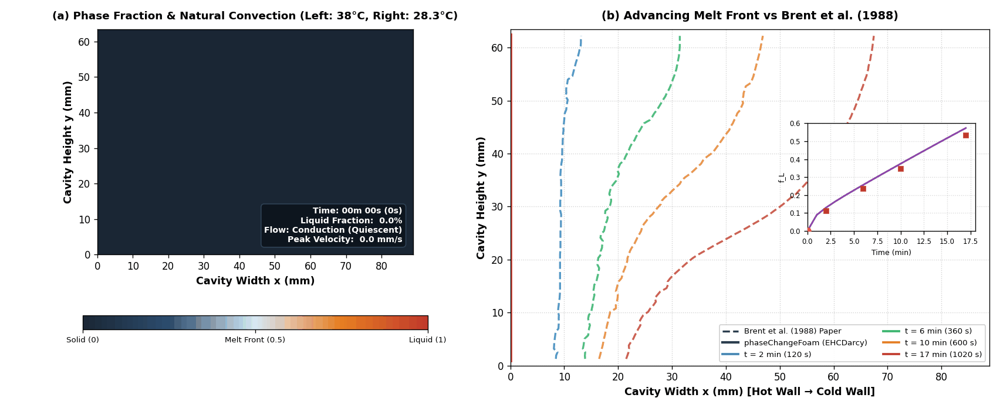
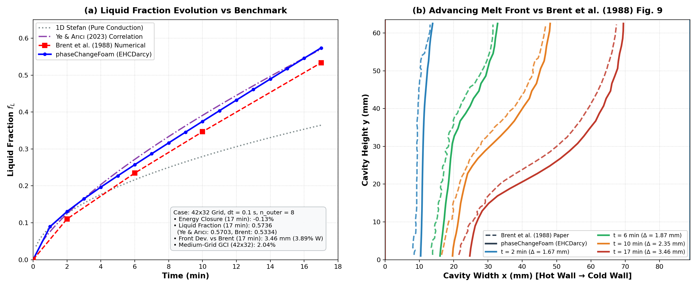

# Benchmark Verification

Quantitative verification suite and benchmark comparisons for `phaseChangeFoam`.

---

## Verification Hierarchy

The benchmark suite verifies natural convection and coupled solid-liquid melting in a two-stage ladder:

```
[ Rung 2: 2D Gallium Melting ]
Brent, Voller, Reid (1988)
Coupled phase change, Darcy mushy drag, natural convection
Transient solver: phaseChangeMultiRegionFoam (Ra ≈ 6e5, Pr = 0.0216, Ste = 0.039)
               ▲
               │  (Verifies coupled thermal & phase change mechanics)
               │
[ Rung 1: 2D Natural Convection Cavity ]
de Vahl Davis (1983)
Buoyancy-driven circulation in square cavity (Ra = 10^5, Pr = 0.71)
Steady-state solver: phaseChangeMultiRegionSimpleFoam
```

---

## Rung 1: Natural Convection Cavity (de Vahl Davis 1983)

* **Directory**: [`validation/deVahlDavis2D/`](../validation/deVahlDavis2D/)
* **Solver**: `phaseChangeMultiRegionSimpleFoam` (steady-state Boussinesq)
* **Runner**: `python3 validation/deVahlDavis2D/runTest.py`

### Setup & Objectives
Laminar buoyancy-driven natural convection in a square cavity ($L = 0.1$ m) filled with air ($\text{Pr} = 0.71$) at $\text{Ra} = 10^5$:
* Left wall: $T_h = 300.5$ K
* Right wall: $T_c = 299.5$ K
* Horizontal walls: Adiabatic ($\partial T / \partial y = 0$)
* Grid: $40 \times 40$ uniform cells
* Objectives: Verify solver pressure-velocity-energy coupling, buoyancy implementation, and hot-wall heat flux convergence.

### Benchmark Results
* **Benchmark target**: Area-averaged hot-wall Nusselt number $\overline{\text{Nu}} = 4.519$ (de Vahl Davis 1983).
* **Acceptance gate**: $\overline{\text{Nu}} = 4.519 \pm 5\%$ ($4.293 \le \overline{\text{Nu}} \le 4.745$).
* **Simulation result**: $\overline{\text{Nu}} = 4.5830$ (1.42% relative difference, 400 SIMPLE iterations, ~2 s execution time).

---

## Rung 2: Gallium Melting Benchmark (Brent et al. 1988)

* **Directory**: [`validation/gallium2D/`](../validation/gallium2D/)
* **Solver**: `phaseChangeMultiRegionFoam` (transient PIMPLE)
* **Runner**: `python3 validation/gallium2D/runTest.py`

Melting of pure gallium in a rectangular enclosure subject to an isothermal hot vertical wall ($T_h = 38.0^\circ\text{C}$) and initial subcooled temperature ($T_{\text{init}} = T_c = 28.3^\circ\text{C}$).

### Benchmark Visualizations





### Benchmark Parameters & Case Setup

| Parameter | Symbol | Value | Unit |
| :--- | :--- | :--- | :--- |
| Cavity width | $W$ | 0.0889 | m |
| Cavity height | $H$ | 0.0635 | m |
| Aspect ratio | $A = H/W$ | 0.714 | - |
| Hot wall temperature | $T_h$ | 311.15 (38.0°C) | K |
| Cold wall / initial temperature | $T_c, T_{\text{init}}$ | 301.45 (28.3°C) | K |
| Melting temperature | $T_m$ | 302.93 (29.78°C) | K |
| Numerical melting window | $\Delta T_m$ | 0.5 | K |
| Latent heat of fusion | $L$ | 80160 | J/kg |
| Density (reference) | $\rho_0$ | 6095 | kg/m3 |
| Specific heat capacity | $C_p$ | 381.5 | J/(kg K) |
| Thermal conductivity | $k$ | 32.0 | W/(m K) |
| Dynamic viscosity | $\mu$ | 1.81e-3 | Pa s |
| Thermal expansion coefficient | $\beta$ | 1.2e-4 | 1/K |
| Darcy morphology constant | $C_u$ | 1.6e6 | kg/(m3 s) |
| Darcy porosity denominator offset | $q$ | 1.0e-3 | - |
| Stefan number | $\text{Ste} = C_p(T_h - T_m)/L$ | 0.0391 | - |
| Prandtl number | $\text{Pr} = \nu / \alpha$ | 0.0216 | - |
| Rayleigh number | $\text{Ra} = g \beta (T_h - T_m) H^3 / (\nu \alpha)$ | 6.06e5 | - |
| Baseline grid | $N_x \times N_y$ | $42 \times 32$ | cells |
| Time step size | $\Delta t$ | 0.1 | s |
| Outer correctors | $n_{\text{outer}}$ | 8 | - |

---

### Quantitative Comparison: Models vs. Benchmark

The table compares `EHCDarcy` and `enthalpyPorosity` ($\lambda = 1.0$) on the $42 \times 32$ grid to the Brent et al. (1988) numerical benchmark:

| Metric | Target | EP ($\lambda = 1.0, n=8$) | EHCDarcy ($n=3$) | EHCDarcy ($n=8$) |
| :--- | :---: | :---: | :---: | :---: |
| **Energy closure ($t = 2$ min)** | $\le 2.0\%$ | -0.06% (-1.2 J) | -0.38% (-7.2 J) | -0.34% (-6.4 J) |
| **Energy closure ($t = 6$ min)** | $\le 2.0\%$ | +0.11% (+4.2 J) | -0.26% (-9.6 J) | -0.23% (-8.4 J) |
| **Energy closure ($t = 17$ min)** | $\le 2.0\%$ | -0.10% (-8.0 J) | -0.16% (-12.7 J) | -0.13% (-10.3 J) |
| **Mean front deviation ($t = 2$ min)** | $\le 5.0\% W$ | 1.71 mm (1.92% W) | 1.68 mm (1.89% W) | 1.67 mm (1.88% W) |
| **Mean front deviation ($t = 6$ min)** | $\le 5.0\% W$ | 1.98 mm (2.23% W) | 1.88 mm (2.11% W) | 1.87 mm (2.10% W) |
| **Mean front deviation ($t = 10$ min)** | $\le 5.0\% W$ | 2.51 mm (2.82% W) | 2.37 mm (2.67% W) | 2.35 mm (2.64% W) |
| **Mean front deviation ($t = 17$ min)** | $\le 5.0\% W$ | 3.58 mm (4.03% W) | 3.49 mm (3.93% W) | 3.46 mm (3.89% W) |
| **Liquid fraction $f_L$ ($t = 17$ min)** | 0.5334 (Brent) | 0.5745 | 0.5732 | 0.5736 |
| **Execution time (2-min run)** | - | 56.4 s | 15.6 s | 48.2 s |

*Brent (1988) curves were digitized from published figures with an estimated digitization uncertainty of $\pm 0.5$ to $1.0$ mm. Observed spatial deviations (1.67–3.46 mm) are comparable to the front's diffuse numerical thickness ($\Delta T_m = 0.5$ K, cell width $\Delta x \approx 2.1$ mm).*

---

### Formulation Notes: EHCDarcy vs. Enthalpy-Porosity

* **EHCDarcy**: Incorporates latent heat directly into the left-hand matrix capacity through effective heat capacity $C_{p,\text{eff}}(T)$. Energy closure plateaus at approximately $-0.35\%$ to $-0.13\%$ across $n_{\text{outer}} \ge 3$, indicating that the remaining discrepancy is dominated by spatial/temporal discretization rather than outer iteration count.
* **Enthalpy-Porosity**: Evaluates latent heat explicitly via source terms and updates liquid fraction via Newton projection. Under-relaxation (e.g. $\lambda = 0.2$) causes severe under-correction and energy surplus. Full Newton stepping ($\lambda = 1.0$) is required; however, explicit source terms exhibit mild oscillation across outer iterations.
* **Computational efficiency**: On this specific 2D benchmark ($42 \times 32$ grid, $\Delta t = 0.1$ s), `EHCDarcy` with $n_{\text{outer}} = 3$ satisfies the $2.0\%$ energy closure target in 15.6 s CPU time, roughly $3.6\times$ faster than `enthalpyPorosity` at $n_{\text{outer}} = 8$ (56.4 s).

---

### Discrete Energy Balance Formulation

In OpenFOAM's finite-volume formulation with implicit backward-Euler time discretization (`ddtSchemes { default Euler; }`), the discrete energy change in cell $P$ over time step $\Delta t_n = t_n - t_{n-1}$ is evaluated at the current time level $t_n$:

$$\Delta E_{\text{stored}}^n = \dot{Q}_{\text{net}}(t_n)\,\Delta t_n$$

The corresponding discrete boundary energy input is the right-endpoint Riemann sum:

$$E_{\text{net, in}}(t_N) = \sum_{n=1}^N \dot{Q}_{\text{net}}(t_n)\,\Delta t_n$$

Using trapezoidal integration for $E_{\text{net, in}}$ introduces a quadrature mismatch against the backward-Euler matrix storage because the intense initial conduction spike ($\dot{Q}(0.1\text{ s}) \approx 81\text{ W}$) decays rapidly. Evaluating the energy audit using right-endpoint summation ensures mathematical consistency with the underlying discrete algebraic equations.

---

### Spatial Grid Convergence & GCI

Grid sensitivity was evaluated for `EHCDarcy` across three structured grids:
* Coarse: $32 \times 24$ cells ($r_{32} = 1.31$)
* Medium: $42 \times 32$ cells ($r_{21} = 1.50$)
* Fine: $63 \times 48$ cells

Results at $t = 17$ min:
* **Mid-height front position ($y/H = 0.5$)**: $x_{\text{front}} = 43.1$ mm (coarse), $44.9$ mm (medium), $45.8$ mm (fine).
* **Observed order ($p$)**: Formal calculation at this single point yields an apparent spatial order of $p = 2.70$. In moving boundary problems, non-linear phase transitions combined with first-order Euler time discretization can lead to apparent observed orders that exceed nominal spatial scheme orders. Three grid levels provide an operational sensitivity estimate rather than definitive proof of the asymptotic range.
* **Grid Convergence Index (GCI)**:
  * Medium grid ($42 \times 32$): $\text{GCI}_{21} = 2.04\%$
  * Fine grid ($63 \times 48$): $\text{GCI}_{10} = 0.67\%$
* **Global liquid fraction**: $f_L$ values across the three grids are $0.5682 \to 0.5736 \to 0.5725$, showing less than $1\%$ spread between medium and fine grids.

---

### Comparison with Benchmark Literature

* **Brent et al. (1988)**: The present computed front morphology captures the top-dominant melting progression. The computed liquid fraction ($0.5736$ at 17 min) sits above Brent et al.'s 1988 coarse prediction ($0.5334$).
* **Hannoun et al. (2003)**: Resolved historical variations in numerical gallium melting, verifying that adequate spatial resolution and proper Darcy morphology damping produce front morphologies consistent with Ye and Arıcı (2023) and the present study.
* **Ye and Arıcı (2023)**: Eq. (6) provides a grid-converged numerical correlation for 2D pure gallium melting:
  $$\phi_n = 2.708\,\tau^{0.712}\,\text{Ra}^{0.0243}\,\text{Ar}^{-0.0515}$$
  At $t = 17$ min ($1020$ s), the correlation predicts $\phi_n = 0.5703$. `phaseChangeFoam` yields $f_L = 0.5736$, agreeing within $0.58\%$ ($+0.33$ percentage points).
* **Code-to-code verification vs. physical experiment**: Comparisons against Brent et al. (1988) and Ye and Arıcı (2023) represent code-to-code verification of numerical formulations. Physical experiments on gallium melting (Gau and Viskanta 1986) involve experimental factors not present in the 2D benchmark: thermal inertia of heating jackets, crystal anisotropy ($k \in [28, 41]$ W/(m K)), and 3D boundary layer drag on cavity side walls.

---

## Running the Verification Suite

Run the steady-state natural convection test (Rung 1, ~2 s):
```bash
python3 validation/runAll.py --fast
```

Run the complete validation ladder (Rung 1 + Rung 2 regression gate, ~37 s):
```bash
python3 validation/runAll.py
```

Run individual benchmark cases:
```bash
# Rung 1: de Vahl Davis cavity
cd validation/deVahlDavis2D
python3 runTest.py

# Rung 2: Gallium melting (2-minute regression gate)
cd validation/gallium2D
python3 runTest.py
```
